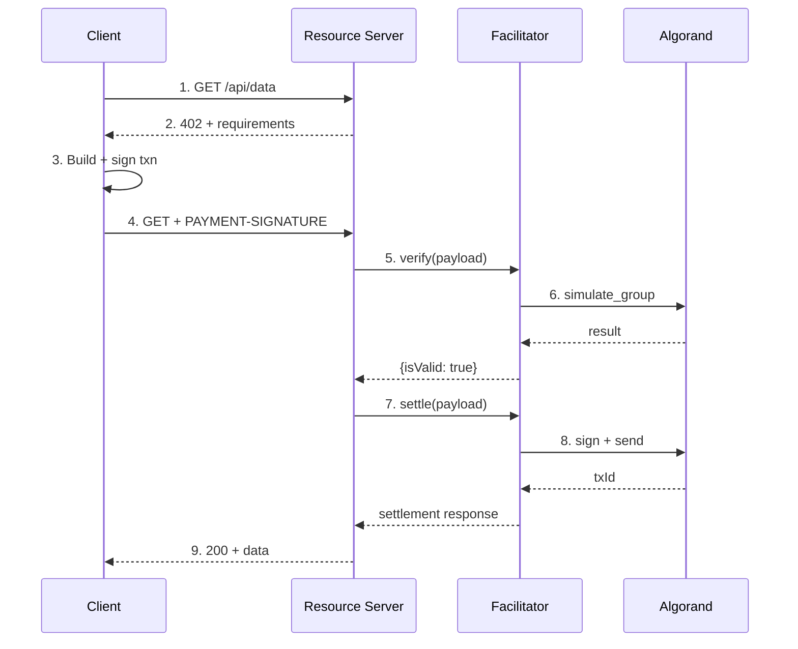

<Frame>
  

    

      
    

    
      x402 on Algorand
    
    <h1 style={{ fontSize: "2.25rem", fontWeight: 700, margin: "0.5rem 0", color: "white" }}>
      Prove your facilitator can't be cheated
    </h1>
    

      Ward is an adversarial test framework that runs real, tampered payments against a real x402
      facilitator and reports exactly which correctness guarantees hold — with reproducible,
      on-chain evidence for every result.
    

  

</Frame>

## What Ward does

Every x402 facilitator promises the same thing: verify a payment correctly, then settle exactly
what was verified. Nothing more, nothing less, exactly once.

Ward checks whether a given facilitator actually keeps that promise. It plays the adversary
itself — building real, correctly-signed payments, then deliberately tampering with them:

- A mutated amount
- A redirected receiver
- An unsigned fee-payer leg, rewritten after signing
- A key that's no longer the account's spending authority

Then it asserts that the facilitator's `/verify` and `/settle` endpoints reject exactly what they
should.

Nothing here is mocked. Ward drives a real, self-hosted facilitator process end to end and reports
pass/fail with the full request and response trail behind every result.

<CardGroup cols={2}>
  <Card title="Quickstart" icon="rocket" href="/quickstart">
    Fund accounts, boot a facilitator, and run the full guarantee suite in a few commands.
  </Card>
  <Card title="Correctness Guarantees" icon="shield-check" href="/invariants/overview">
    The eight properties Ward checks, and exactly what each one proves.
  </Card>
  <Card title="Command Line" icon="square-terminal" href="/cli/overview">
    `ward init`, `ward test`, `ward fuzz`, and `ward report` in detail.
  </Card>
  <Card title="Hosted Verification API" icon="cloud" href="/server/overview">
    A paid, x402-gated HTTP endpoint that runs Ward against any facilitator URL you submit.
  </Card>
</CardGroup>

## Why it exists

A USENIX Security '26 study tested 15 major x402 facilitators — collectively serving over 60,000
sellers and 360,000 buyers — and found authorization-correctness violations in **every single
one**, spread across four classes:

<CardGroup cols={2}>
  <Card title="Free Shopping" icon="cart-shopping">
    A client gets a resource without ever paying the amount the facilitator approved.
  </Card>
  <Card title="Asset Theft" icon="hand-holding-dollar">
    Funds are moved to a receiver, amount, or asset the client never actually authorized.
  </Card>
  <Card title="Service Denial" icon="ban">
    Legitimate payments are rejected, or the facilitator can be knocked into a broken state.
  </Card>
  <Card title="Gas Abuse" icon="gauge-high">
    A client forces the facilitator to spend unbounded, uncapped work rejecting doomed payments.
  </Card>
</CardGroup>

No facilitator in that study shipped with an automated way to verify it *doesn't* have these
problems. Ward is that missing test framework.

It's Algorand-first today, with a chain-agnostic core — so a second chain is a new adapter, not a
rewrite. See [Architecture](/architecture) for how that separation is enforced in code, not just
claimed.

## Two ways to use Ward

<Tabs>
  <Tab title="Run it yourself">
    Clone the repository, self-host a facilitator with Docker Compose, and run `ward test` from
    the CLI against it. This is the right choice if you're building or operating a facilitator and
    want the full evidence trail on your own machine. See the [Quickstart](/quickstart).
  </Tab>
  <Tab title="Pay for a hosted check">
    Ward also ships as a small x402-gated HTTP service: `POST /verify-facilitator` with a
    facilitator URL, pay $1.00 over x402, and get the same pass/fail report back — no local setup
    required. See [Hosted Verification API](/server/overview).
  </Tab>
</Tabs>

## What Ward tests against

Ward runs against [GoPlausible's x402-avm facilitator](https://github.com/GoPlausible/x402-avm),
self-hosted via Docker Compose. It uses the `branch-v2-algorand-publish` branch — since adopted
into the official `x402-foundation/x402` monorepo — and never the shared, public
`facilitator.goplausible.xyz` instance.

Every finding Ward produces is about a real, running facilitator process Ward controls end to
end — never shared or production infrastructure.

## How a check runs, end to end

Ward plays every role in this diagram *except* the facilitator, then tampers with the payload at
the point a real attacker would — after the client signs, before the facilitator settles.

## Ground truth, not guesses

Every wire shape and validation rule Ward relies on was read directly from the installed
`@x402/core` / `@x402/avm` package source:

- `PaymentRequirements` and `PaymentPayload`
- The exact fee-abstraction group layout
- The facilitator's complete `verify()`/`settle()` algorithm, including its error codes

None of it was inferred from documentation — which turned out to diverge from the real
implementation in several places. See the [Decision Log](/reference/decision-log) for the full
paper trail.
